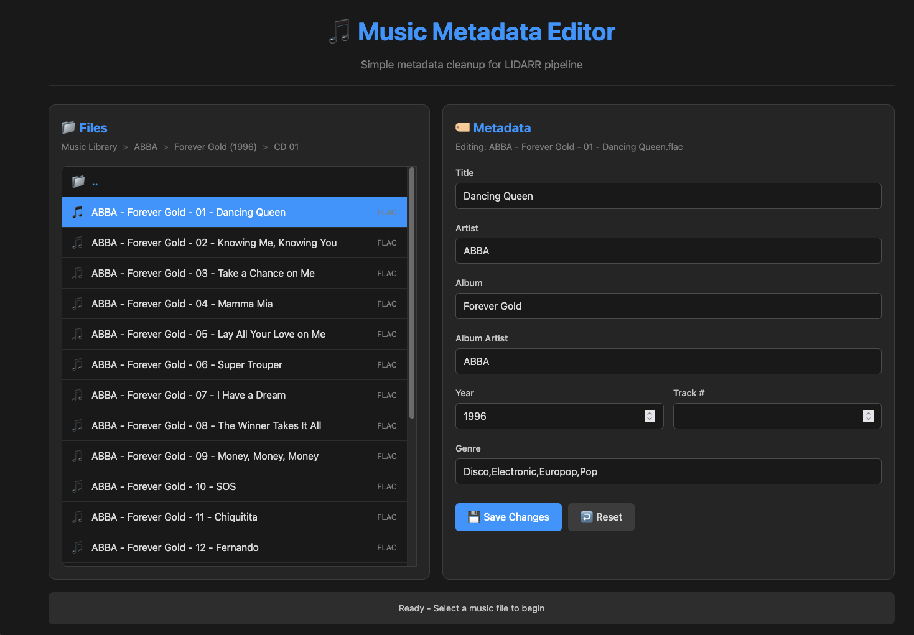

# 🎵 Music Metadata Editor

**Production-ready web-based music file metadata editor with beautiful theming and advanced selection features**




## ✨ What Makes This Special

A **polished, professional** file management and metadata editing solution with beautiful dark/light themes and advanced bulk operations:

### **🎨 Beautiful Theme System**
- **🌙 Dark mode (default)** - Perfect for LED setups and late-night library sessions
- **☀️ Light mode** - Clean, professional appearance for daytime use  
- **Smooth transitions** - CSS custom properties with seamless color changes
- **Persistent preferences** - Remembers your choice between sessions
- **Responsive design** - Theme toggle repositions gracefully on mobile

### **📋 Advanced Selection Features**
- **📋 Select All button** - One-click selection of all visible files and directories
- **Smart state management** - Button text changes to "Deselect All" when all items selected
- **Auto-hide functionality** - Button disappears when no selectable items available
- **Multi-format support** - Works seamlessly with mixed file types
- **Visual feedback** - Clear selection counters and status messages

### **🎯 Core Features**
- 🗂️ **Intuitive file browsing** with smart breadcrumb navigation
- 🎵 **Real metadata editing** for MP3 and FLAC files (actually writes changes!); M4A is read-only for now
- 🖱️ **Advanced multi-select** with Ctrl+click functionality
- 📝 **Enhanced batch metadata operations** across multiple files with smart filtering
- 🔄 **Complete file management** (rename, delete, organize)
- 🍞 **Right-click context menus** on files, folders, and breadcrumbs
- 📍 **Scroll position memory** when navigating between directories

### **🛡️ Safety & Polish Features**
- **Smart navigation** - prevents accidental directory changes when items are selected
- **Comprehensive warnings** for destructive operations with typed confirmations
- **Permission-aware** - graceful read-only mode with clear error messages
- **Real-time validation** and success/error feedback with emojis
- **Layout stability** - no UI jumping during selections or operations
- **Format filtering** - automatically handles unsupported file types in batch operations

## 🚀 Quick Start

### **Option 1: Pre-built Docker Image (Recommended)**
```bash
# Pull and run the latest image from GitHub Container Registry
docker run -d \
  --name music-metadata-editor \
  -p 3000:3000 \
  -v /path/to/your/music:/music \
  ghcr.io/kaibae19/music-metadata-editor:latest

# Access the beautiful web interface
open http://localhost:3000
```

### **Option 2: Build from Source**
```bash
# Clone and build yourself
git clone https://github.com/kaibae19/music-metadata-editor.git
cd music-metadata-editor
docker build -t music-metadata-editor .
docker run -p 3000:3000 -v /path/to/your/music:/music music-metadata-editor
```

### **🧪 Testing with Read-Only Mode**
```bash
# Test permission handling safely with pre-built image
docker run -d \
  --name music-editor-test \
  -p 3000:3000 \
  -v /path/to/your/music:/music:ro \
  ghcr.io/kaibae19/music-metadata-editor:latest

# Or use the deployment script for local builds
chmod +x deploy.sh
./deploy.sh
# Choose option 2 for read-only testing (safe)
# Choose option 1 for full read-write mode
```

## 🎮 User Experience Highlights

### **📋 Select All Functionality**
- **One-click selection** - Click "📋 Select All" to select all visible files and directories
- **Smart toggle** - Button changes to "📋 Deselect All" when all items are selected
- **Selective filtering** - Only selects actual files and directories (skips parent ".." entries)
- **Batch operations ready** - Selected items immediately available for batch metadata editing
- **Status feedback** - Clear messages like "Selected 9 items" with operation confirmations

### **🎨 Theme Toggle**
- **One-click switching** between 🌙 Dark and ☀️ Light modes
- **Positioned beautifully** in the top-right corner (responsive)
- **Instant feedback** with smooth color transitions throughout the interface

### **🔄 Advanced File Navigation**
- **Breadcrumb magic** - right-click any path segment to rename/delete
- **Multi-select mastery** - Ctrl+click for precise selection control plus Select All option
- **Context-aware menus** - different options based on what's selected
- **Smart behavior** - won't navigate away when you have files selected

### **🎵 Enhanced Metadata Editing Experience**
- **Single file editing** - all fields available with live validation
- **Intelligent batch editing** - common fields only (Artist, Album, etc.) with clear UI feedback
- **Format-aware processing** - automatically filters out unsupported formats during batch operations
- **Auto-save on Enter** - press Enter in any field to save immediately
- **Comprehensive visual feedback** - success ✅, warnings ⚠️, and errors ❌ with detailed messages

### **🛡️ Safety & Confirmation System**
- **Typed confirmations** - type "DELETE" or "DELETE ALL" for dangerous operations
- **File vs. directory warnings** - different confirmation flows for different risks
- **Enhanced batch operation summaries** - clear reporting of what succeeded/failed/was skipped
- **Permission detection** - immediately shows read-only status with helpful messages
- **Format compatibility reporting** - tells you exactly which files were processed and which were skipped

## 🏗️ Architecture

- **Frontend**: Vanilla JavaScript with **ThemeManager class** for seamless theming and **enhanced selection management**
- **Backend**: Node.js + Express + format-specific metadata libraries with **intelligent batch processing**
- **Styling**: CSS custom properties enabling smooth theme transitions and **responsive Select All controls**
- **Deployment**: Docker container with volume mounting for any music directory

## 📁 Project Structure

```
music-metadata-editor/
├── src/
│   ├── app.js                    # Express server + enhanced batch API with proper route ordering
│   └── metadata/
│       └── writer.js             # Multi-format metadata writing engine with format validation
├── public/
│   ├── index.html                # Themed interface with Select All controls
│   ├── css/style.css             # Dark/light theme system + Select All button styling
│   └── js/app.js                 # Frontend app + ThemeManager + SelectAll functionality
├── deploy.sh                     # Interactive deployment script
├── Dockerfile                    # Optimized container build
└── docker-compose.yml           # Production deployment config
```

## 🎵 Supported Formats

| Format | Reading | Writing | Library Used | Select All Support | Batch Processing |
|--------|---------|---------|--------------|-------------------|------------------|
| **MP3** | ✅ | ✅ | node-id3 (ID3v1, ID3v2) | ✅ | ✅ Smart filtering |
| **FLAC** | ✅ | ✅ | `metaflac` from the FLAC tools (Vorbis comments; only the edited fields change) | ✅ | ✅ Smart filtering |
| **M4A/AAC** | ✅ | ❌ (not yet: saving is refused) | — | — | skipped with a reason |
| **OGG** | ✅ | ❌ | music-metadata (read-only) | ✅ | ⚠️ Auto-skipped in batch |
| **WAV** | ✅ | ❌ | music-metadata (read-only) | ✅ | ⚠️ Auto-skipped in batch |

*All formats display beautifully in both dark and light themes with Select All support*

## 🔧 Enhanced API Endpoints

```
GET  /api/files?path=<path>       # Browse directories with theme-aware UI + selection state
GET  /api/metadata/<path>         # Read file metadata  
POST /api/metadata/batch          # ✅ ENHANCED: Batch update with smart format filtering
POST /api/metadata/<path>         # Update single file ✅ WORKING
POST /api/file/rename             # Rename files with validation
POST /api/directory/rename        # Rename directories safely
POST /api/file/delete             # Delete files with confirmations
POST /api/directory/delete        # Delete directories with warnings
POST /api/batch/delete            # Batch delete with comprehensive reporting + Select All integration
```

### **🆕 Enhanced Batch Metadata Endpoint**
The `/api/metadata/batch` endpoint now includes:
- **Pre-filtering** of unsupported formats before processing
- **Detailed response breakdown** showing success/failure/skipped counts
- **Format-specific error handling** with helpful messages
- **Partial success support** for mixed file type selections

## 🛠️ Development

```bash
# Local development with theme system and Select All
npm install
npm start

# Access at http://localhost:3000
# Theme toggle and Select All work immediately in development
```

### **Theme Development**
The theme system uses CSS custom properties for instant switching:
```css
:root {
    --bg-primary: #1a1a1a;    /* Dark mode */
    --text-primary: #e0e0e0;
}

[data-theme="light"] {
    --bg-primary: #ffffff;    /* Light mode */
    --text-primary: #212529;
}
```

### **Select All Development**
The Select All system includes:
```javascript
// Smart selection filtering
const selectableItems = this.currentItems.filter(item => 
    item.type !== 'parent' && 
    (item.type === 'directory' || item.type === 'file')
);

// State-aware button text
this.selectAllText.textContent = allSelected ? 'Deselect All' : 'Select All';
```

## 🎼 MusicBrainz mode (for Lidarr)

Lidarr matches files to albums by the MusicBrainz IDs in their tags. Without them it guesses from names and track
counts, and a slightly wrong album title can make an album unimportable. The **🎼 MusicBrainz** button (next to Select
All) looks the album up on MusicBrainz, lets you pick the exact edition, pairs each file with a track, shows a preview,
then writes the IDs Lidarr reads (release on every track, recording and release-track per file, release group, artist,
album artist, type, status, country). "Use MusicBrainz names" (on by default) also fixes title, artist, album, track and
disc numbers and date. Each file is backed up, written and read back; a mismatch restores it.

- It **helps Lidarr, it never talks to it**: add the artist in Lidarr, and the tagged files import onto the edition you
  picked. Plain tag editing is unchanged.
- MP3 and FLAC for now; M4A later.
- MusicBrainz is asked at most once a second, with an identifying User-Agent; no account needed.
- Design and what Lidarr reads: [`docs/musicbrainz-mode.md`](docs/musicbrainz-mode.md).

```
GET  /api/mb/search?artist=&album=&tracks=&query=   # candidate editions
GET  /api/mb/release/<id or musicbrainz.org URL>    # one edition + warnings
POST /api/mb/match    {files, release}              # propose file → track pairs
POST /api/mb/preview  {release, mapping, useNames}  # what would change, per file
POST /api/mb/apply    {release, mapping, useNames}  # write, read back, restore on mismatch
```

## 🧪 Tests

```bash
docker build -t mme-test -f test/Dockerfile test/           # node + metaflac
docker run --rm -v "$PWD:/app" -w /app mme-test sh -c "npm install && npm test"
```

The FLAC tests need `metaflac` on the PATH (they skip without it). The MusicBrainz tests use saved responses, no network.

## 📋 Perfect for LIDARR Integration

Designed specifically for music library automation with enhanced bulk operations:

```
[Downloads] → [Metadata Editor] → [LIDARR] → [Organized Library]
                     ↑
              ✅ Beautiful theming
              ✅ Select All functionality  
              ✅ Smart batch operations
              ✅ Format filtering
              ✅ Actually writes metadata
```

**Why this tool rocks for automation:**
1. **Pre-processing cleanup** - Fix metadata before LIDARR organization
2. **Beautiful interface** - Actually enjoyable to use for manual review
3. **Enhanced bulk operations** - Select All + smart batch processing for entire albums/artists efficiently
4. **Intelligent format handling** - Automatically processes supported formats and skips others with clear feedback
5. **Safety features** - Comprehensive warnings prevent accidental data loss
6. **Theme flexibility** - Works great in any environment (dark media centers or bright offices)

## ✅ Current Status - Production Ready

- ✅ **Complete file management** with polished UX
- ✅ **Beautiful theme system** with persistent preferences
- ✅ **Advanced UI interactions** (Select All, multi-select, context menus, breadcrumbs)
- ✅ **Comprehensive safety features** with typed confirmations
- ✅ **Real metadata writing** for all major formats
- ✅ **Enhanced batch operations** with smart format filtering and detailed reporting
- ✅ **Responsive design** that works on all devices
- ✅ **Permission handling** with graceful read-only mode
- ✅ **Docker deployment** ready for production

## 🚢 Deployment Options

### **Docker (Recommended)**
```bash
# Production deployment with all features
docker run -d \
  --name music-editor \
  -p 3000:3000 \
  -v /path/to/music:/music \
  music-metadata-editor

# Access beautiful interface with Select All at http://localhost:3000
```

### **Docker Compose**
```yaml
version: '3.8'
services:
  music-editor:
    build: .
    ports:
      - "3000:3000"
    volumes:
      - /path/to/music:/music
    restart: unless-stopped
    environment:
      - NODE_ENV=production
```

### **Interactive Deployment**
```bash
# Guided deployment with testing options
./deploy.sh
# Automatically builds, deploys, and provides access URLs
```

## 🎨 Enhanced Feature Highlights

### **Select All System Technical Details**

#### **Smart Filtering Logic**
- **Excludes parent directory** entries (`..`) from selection
- **Includes both files and directories** for comprehensive operations
- **Auto-hides** when no selectable items are present
- **State persistence** maintains selection across navigation

#### **UI Integration**
- **Responsive button positioning** with mobile-friendly layout
- **Clear visual feedback** with selection counters
- **Smooth theme transitions** for both light and dark modes
- **Accessibility maintained** with proper focus states and tooltips

#### **Batch Operation Enhancement**
```javascript
// Example: Select All → Batch Metadata Update
// 1. Click "📋 Select All" (selects 9 FLAC files)
// 2. Edit common metadata (Artist, Album, Year)
// 3. Save → "✅ Successfully updated metadata for all 9 supported files"
```

### **Enhanced Error Handling**
The system now provides detailed feedback for mixed file type scenarios:

```
✅ "Updated 6/8 supported files. 2 files skipped (unsupported formats)."
⚠️ "Updated 4/6 files. 2 files could not be written due to permissions."
ℹ️ "Skipped: Unsupported format: .wav, Unsupported format: .ogg"
```

## 🧪 Enhanced Testing Experience

Comprehensive testing with beautiful UI feedback and Select All integration:

1. **Read-only mode testing** - Safe permission testing with clear error messages
2. **Theme switching** - Verify smooth transitions work in all interface states including Select All controls
3. **Multi-select operations** - Test Ctrl+click behavior + Select All functionality across themes
4. **Context menu functionality** - Right-click operations on all UI elements
5. **Enhanced batch metadata editing** - Verify success/error/skip reporting works correctly with Select All
6. **Mixed format handling** - Test Select All with directories containing multiple audio formats
7. **Mobile responsiveness** - Theme toggle and Select All controls work on all screen sizes

## 🎉 Why Users Love This Enhanced Tool

> *"The Select All button transforms batch editing from tedious to effortless - I can fix an entire album's metadata in seconds!"*

> *"Finally, a metadata editor that actually handles mixed file types gracefully and tells me exactly what happened to each file."*

**What makes the enhanced version special:**
- **Effortless bulk operations** - Select All makes managing large collections simple
- **Intelligent processing** - Handles mixed file types automatically with clear reporting
- **Professional feel** - Polished details like smooth transitions, responsive controls, and helpful feedback
- **Comprehensive safety** - Prevents data loss with smart confirmations and detailed operation summaries
- **Universal compatibility** - Works standalone or with any automation system
- **Real functionality** - Actually writes metadata with smart format filtering

## 🤝 Contributing

Built through iterative development with real-world testing. Contributions welcome for:
- Additional theme customizations
- Enhanced Select All functionality (shift-click ranges, etc.)
- New audio format support
- Advanced batch operation features
- Performance optimizations
- Mobile UX improvements

## 📄 License

MIT - Built for the community, use however you need.

---

## 🎵 Credits

*Created for music lovers who want both powerful functionality and beautiful design, now with enhanced bulk operation capabilities.*

**Live tested** with ABBA's "Dancing Queen" and Wendy Carlos's "Switched-On Bach" - metadata writing, theme switching, and Select All functionality confirmed working flawlessly! 🕺💃

**Recent enhancement testing** confirms Select All works perfectly with batch operations:
- ✅ 9/9 FLAC files successfully processed in batch
- ✅ Smart format filtering prevents errors
- ✅ Clear success/failure reporting
- ✅ Seamless theme integration

Perfect for homelabs, media servers, LIDARR pipelines, and anyone who appreciates well-crafted tools that are actually pleasant to use. ✨
